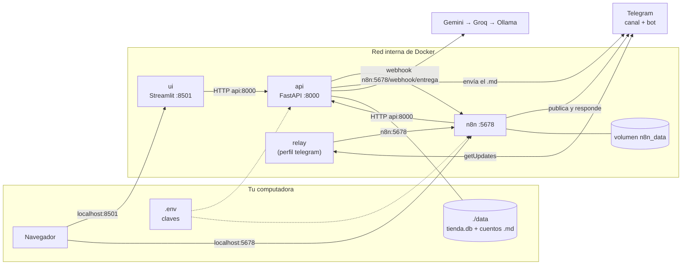

# Arquitectura

El sistema se compone de cuatro contenedores que se levantan juntos con `docker compose up -d --build`. Los tres servicios escritos en Python (API, panel y relay) comparten una misma imagen construida con el `Dockerfile`; cada uno solo cambia el comando de arranque. n8n usa su imagen oficial.

## Qué hay adentro de cada contenedor y qué queda afuera

| Contenedor | Adentro (imagen) | Afuera (se monta o se inyecta) |
|---|---|---|
| `api` | Python 3.12, dependencias (incluido pytest), todo el código del repo salvo lo que excluye `.dockerignore`. Corre con un usuario sin permisos de administrador | La base SQLite y los cuentos `.md` (carpeta `./data` montada en `/app/data`) y las claves (`.env`) |
| `ui` | La misma imagen; ejecuta `ui/app.py` | Solo la variable `API_URL=http://api:8000` |
| `n8n` | Imagen oficial `n8nio/n8n` | Usuario, credenciales y workflows activos (volumen `n8n_data`); JSON exportados (`./n8n/workflows`) y la clave `N8N_ENCRYPTION_KEY` que cifra las credenciales |
| `relay` | La misma imagen; ejecuta `relay/main.py` | Token del bot (`.env`) |

Los tres servicios de Python usan la misma imagen (`tienda-cuentos:local`): la construye `api` y `ui` y `relay` la reutilizan, así se compila una sola vez. Las claves y los datos nunca quedan dentro de la imagen: el `.dockerignore` excluye `.env` y `data/`. Así la imagen se puede reconstruir o compartir sin exponer secretos, y los datos sobreviven a `docker compose down`.

## Cómo se comunican

Docker Compose crea una red privada donde cada servicio es accesible por su nombre. Por eso, dentro de los contenedores se usa `http://api:8000` y no `localhost`: para un contenedor, `localhost` es él mismo. Desde el navegador de la PC sí se usa `localhost`, porque los puertos están publicados con `ports:`.

La única excepción es Ollama, que corre instalado en la PC y no en Docker. La API lo alcanza con `host.docker.internal`, un nombre especial que apunta a la máquina anfitriona.

## Orden de arranque y salud

La API tiene un `healthcheck` que consulta `/salud` cada 15 segundos. El panel y n8n esperan a que la API esté **healthy** (`depends_on: condition: service_healthy`) antes de arrancar, así nunca muestran errores de conexión al inicio. Todos los servicios tienen `restart: unless-stopped`: si se caen, Docker los vuelve a levantar.

## El panel no tiene lógica de negocio

`ui/cliente_api.py` es el único archivo que habla con la API, y solo hace pedidos HTTP. Las decisiones (si un cuento se puede aprobar, si un pedido se puede entregar, si un pago corresponde) las toma la API. Cuando la API responde un error, el cliente lo traduce a un mensaje con el código y el motivo, por ejemplo `409 · No corresponde al estado actual: El pedido no está pago`, y el panel lo muestra en rojo sin romperse.

Esto cumple con un criterio de la consigna: la interfaz separa visualmente las **validaciones por reglas** (lo que calculó el código) del **contenido generado por IA**.
